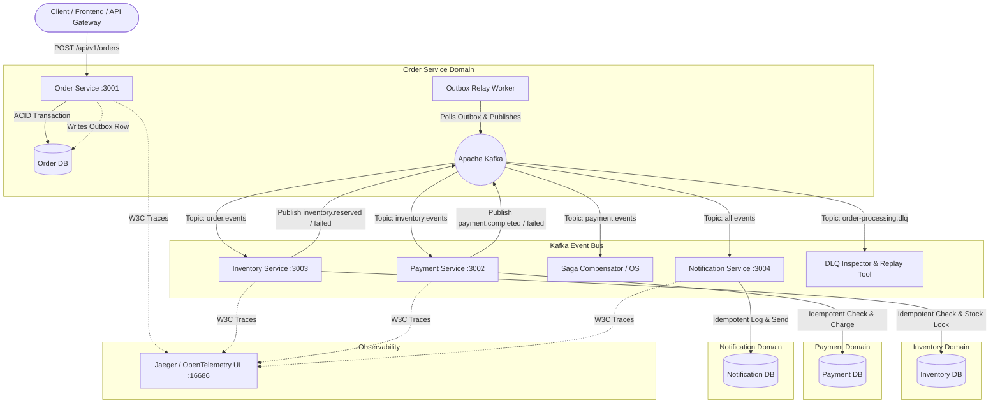

# 📦 Event-Driven Order Processing Microservices Architecture

An enterprise-grade, distributed event-driven microservices order processing pipeline built with **Node.js/TypeScript**, **Apache Kafka (KRaft mode)**, **PostgreSQL (Database-per-Service)**, **OpenTelemetry distributed tracing**, **Jaeger**, **Docker Compose**, and **Kubernetes manifests**.

---

## 🌟 Key Architecture & Distributed Systems Patterns



### 1. Database-Per-Service Pattern
- Four independent microservices (**Order**, **Payment**, **Inventory**, **Notification**), each strictly owning its own PostgreSQL database (`order_db`, `payment_db`, `inventory_db`, `notification_db`).
- Zero shared tables or cross-database foreign keys.

### 2. Transactional Outbox Pattern (Dual-Write Prevention)
- Eliminates the dual-write bug where database writes and event publishing can diverge if the process crashes.
- Database state and event records are committed atomically within a single SQL ACID transaction.
- A dedicated background **Outbox Relay** polls with `FOR UPDATE SKIP LOCKED` and publishes to Kafka with at-least-once delivery guarantees.

### 3. Saga Pattern with Compensating Transactions
- Implements Saga orchestration & choreography for distributed transactions across independent databases:
  - **Happy Path**: Order Placed (`PENDING`) ➔ Inventory Reserved ➔ Payment Charged ➔ Order Confirmed (`CONFIRMED`) ➔ Email Dispatched.
  - **Compensating Path (Payment Failure)**: Payment Fails ➔ Order Saga intercepts failure ➔ Triggers `inventory.released` compensation event ➔ Stock restored to inventory pool ➔ Order transitioned to `CANCELLED` ➔ Cancellation notification sent.

### 4. Idempotent Consumers (Exactly-Once Application Semantics)
- Every consumer wraps domain logic in an atomic `processed_events` table lock keyed on `(event_id, handler_name)`.
- Replaying the same event 3x or 100x has **zero duplicate side-effects** (no duplicate charges or double reservations).

### 5. Dead Letter Queue (DLQ) & Admin Replay Tool
- Messages failing downstream execution after exponential backoff retries route automatically to `order-processing.dlq`.
- Includes an admin CLI tool (`npm run dlq:inspect` / `npm run dlq:replay`) to inspect and replay poisoned messages.

### 6. Distributed Tracing with OpenTelemetry & W3C TraceContext
- Injects `traceparent` headers across HTTP requests and Kafka message headers.
- Visualizes the entire lifecycle of a single order end-to-end across all 4 microservices in Jaeger UI (`http://localhost:16686`).

---

## 🚀 Quick Start with Docker Compose

### Prerequisites
- [Docker & Docker Compose](https://docs.docker.com/get-docker/) installed.
- Node.js 20+ (optional, for running scripts locally).

### 1. Start Entire Infrastructure & Microservices
```bash
docker compose up -d
```

This starts:
- **PostgreSQL 16**: Port `5432` (with isolated `order_db`, `payment_db`, `inventory_db`, `notification_db`, `monolith_db`).
- **Apache Kafka (KRaft mode)**: Port `9092` & `29092`.
- **Kafka-UI**: Port `8080` (Web UI to inspect topics & consumer groups).
- **Jaeger UI**: Port `16686` (Web UI for distributed tracing).
- **Order Service**: Port `3001`.
- **Payment Service**: Port `3002`.
- **Inventory Service**: Port `3003`.
- **Notification Service**: Port `3004`.
- **Monolith Reference Service**: Port `3000`.

### 2. View Service UIs
- **Kafka Web Management UI**: [http://localhost:8080](http://localhost:8080)
- **Jaeger Distributed Tracing UI**: [http://localhost:16686](http://localhost:16686)

---

## 🧪 Interactive 8-Step Verification Journey

Run the comprehensive automated demo script that tests every step required by the project:

```bash
npm install
npm run demo:all
```

### Breakdown of the 8 Steps:
1. **Monolith Benchmark**: Demonstrates single-database ACID transaction simplicity.
2. **Synchronous Degradation Demo**: Simulates downstream payment latency blocking the main thread pool.
3. **Eventual Consistency Flow**: Shows immediate HTTP 202 Accepted response and asynchronous background completion.
4. **Transactional Outbox Verification**: Verifies atomic write + relay publishing.
5. **Idempotency Protection Test**: Replays duplicate messages and proves 0 duplicate side-effects.
6. **Saga Compensation Test**: Injects payment failure and verifies stock release and order cancellation.
7. **Dead Letter Queue (DLQ)**: Verifies poison message isolation and replay.
8. **OpenTelemetry Tracing**: Shows end-to-end trace correlation in Jaeger.

---

## 📡 REST API Examples

### 1. Create an Order (Event-Driven Asynchronous)
```bash
curl -X POST http://localhost:3001/api/v1/orders \
  -H "Content-Type: application/json" \
  -d '{
    "customerId": "cust-alice",
    "totalAmount": 2499.00,
    "items": [
      { "itemId": "item-1", "quantity": 1, "unitPrice": 2499.00 }
    ]
  }'
```
**Response (HTTP 202 Accepted):**
```json
{
  "success": true,
  "orderId": "ord-7a1b8c2d",
  "status": "PENDING",
  "message": "Order created and event persisted to Outbox table atomically.",
  "checkStatusUrl": "/api/v1/orders/ord-7a1b8c2d"
}
```

### 2. Check Order Status & Saga Audit Trail
```bash
curl http://localhost:3001/api/v1/orders/ord-7a1b8c2d
```

### 3. Inspect Inventory Stock Levels
```bash
curl http://localhost:3003/api/v1/inventory
```

### 4. Trigger Chaos Mode (Simulate Payment Failure for Saga Compensation)
```bash
curl -X POST http://localhost:3002/api/v1/chaos/fail-next \
  -H "Content-Type: application/json" \
  -d '{ "count": 1 }'
```

### 5. Inspect Sent Notifications
```bash
curl http://localhost:3004/api/v1/notifications
```

---

## 🛠️ Dead Letter Queue (DLQ) Management Tool

### Inspect Failed Messages in DLQ:
```bash
npm run dlq:inspect
```

### Replay Failed Messages from DLQ:
```bash
npm run dlq:replay
```

---

## ☸️ Kubernetes Deployment

To deploy to a Kubernetes cluster (Minikube, EKS, GKE, or Kind):

```bash
kubectl apply -f k8s/00-namespace.yaml
kubectl apply -f k8s/01-configmap-secret.yaml
kubectl apply -f k8s/02-postgres.yaml
kubectl apply -f k8s/03-kafka.yaml
kubectl apply -f k8s/04-jaeger.yaml
kubectl apply -f k8s/05-order-service.yaml
kubectl apply -f k8s/06-payment-service.yaml
kubectl apply -f k8s/07-inventory-service.yaml
kubectl apply -f k8s/08-notification-service.yaml
kubectl apply -f k8s/09-ingress.yaml
```

---

